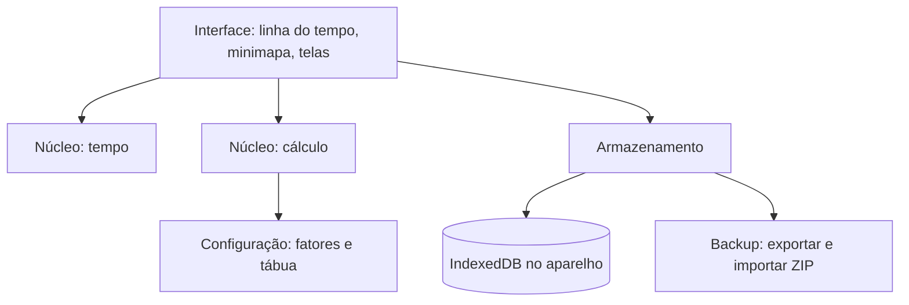

# 6. Arquitetura

As escolhas abaixo são a proposta inicial. As que ainda dependem de confirmação estão marcadas em [Decisões](08-decisoes.md).

## Tecnologias

| Escolha | O que é | Por quê |
|---|---|---|
| Aplicativo web local | Roda no navegador, sem servidor | Cumpre "dados ficam locais" e funciona no computador e no celular |
| TypeScript | JavaScript com tipos | Uma linguagem só para o cálculo e para a interface; os tipos pegam erros cedo e ajudam quem está aprendendo |
| Vite | Ferramenta que roda e empacota o projeto | Configuração mínima; bom suporte no IntelliJ |
| Vitest | Ferramenta de testes | Mesma configuração do Vite; testes do núcleo desde o início |
| Sem framework de interface, no início | HTML, CSS e TypeScript diretos | O protótipo já funciona assim; menos conceitos para aprender. Reavaliar se a interface ficar difícil de manter |
| IndexedDB | Banco de dados do próprio navegador | Guarda dados e fotos no aparelho, sem limite apertado |
| PWA, numa etapa posterior | Permite "instalar" o site como aplicativo | Uso no celular sem loja de aplicativos |

## Separação principal

O sistema tem um **núcleo** sem interface e uma **interface** que só desenha.



- **Núcleo de cálculo:** recebe sexo, idade, respostas e configuração; devolve a curva de sobrevivência e os percentis. Não conhece tela nem banco.
- **Núcleo de tempo:** converte datas em semanas de vida, monta os períodos de cada granularidade e agrupa os vazios.
- **Armazenamento:** lê e grava as entidades; faz exportação e importação.
- **Interface:** junta tudo e desenha.

O núcleo é feito de funções puras: mesma entrada, mesma saída. Isso o torna fácil de testar e de entender.

## Pastas

```
LifeJourney/
├── docs/                  documentação
├── prototipo/             protótipo navegável (referência visual)
├── dados/
│   ├── tabua-ibge-2024.csv
│   └── fatores.json       HRs, prevalências e parâmetros, com fontes
├── src/
│   ├── nucleo/
│   │   ├── calculo/       tábua, risco combinado, sobrevivência, "e se?"
│   │   ├── tempo/         semanas de vida, períodos, agrupamento
│   │   └── tipos.ts       Memória, Capítulo, Intenção, Perfil...
│   ├── armazenamento/     banco local e backup
│   └── interface/
│       ├── linha-do-tempo/
│       ├── minimapa/
│       ├── telas/         memória, capítulo, intenção, questionário, backup
│       └── estilo/        cores, tipografia
├── testes/                testes do núcleo
└── dados-pessoais/        fora do git
```

## Testes

Desde o início, para o núcleo:

| Teste | O que garante |
|---|---|
| Importação da tábua | Expectativas batem com 76,6 / 73,3 / 79,9 / 20,8 / 24,2 |
| Perfil médio | Respostas iguais à média brasileira dão `HR_total` 1,0 |
| Limites | `q'_x` nunca passa de 1; `HR_total` respeita teto e piso |
| Calibração | Diferença entre perfis extremos perto de Li et al. (2018) |
| Tempo | Semana de vida correta para datas conhecidas; períodos vazios agrupados |
| Backup | Exportar e importar devolve os mesmos dados, sem duplicar |

## Desempenho

A rolagem só cria os elementos dos períodos com conteúdo; os vazios viram uma faixa. No protótipo, a vida inteira em nível Semana gera cerca de 135 linhas. O minimapa é desenhado em `<canvas>`, porque são cerca de 5.000 semanas.

Com muitos anos de uso e centenas de memórias, pode ser preciso desenhar só o trecho visível. Isso fica para quando for necessário.
