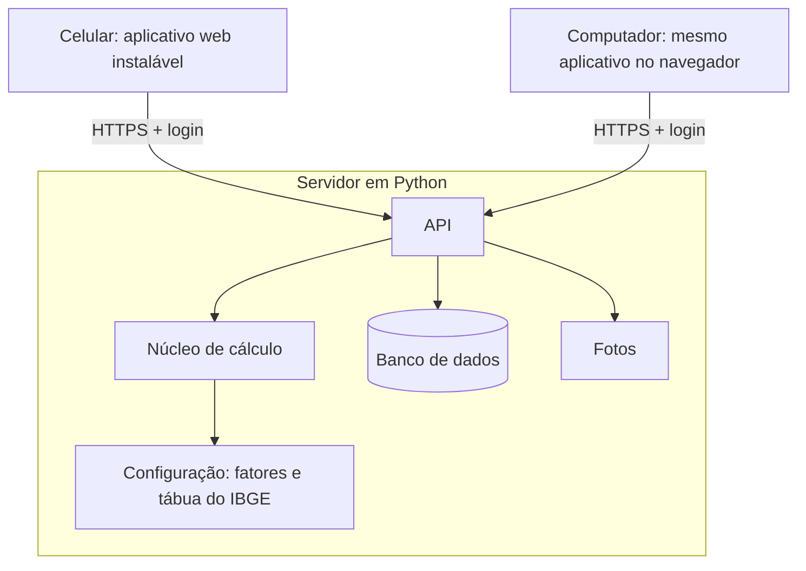

# 6. Arquitetura

## Visão geral

O sistema tem duas partes: um **servidor em Python**, que guarda os dados e faz o cálculo, e um **aplicativo web para celular**, que mostra a linha do tempo.



Todos os aparelhos falam com o mesmo servidor. É isso que mantém os dados sincronizados: o que é registrado no celular aparece no computador ao abrir a página.

## Por que duas linguagens

O núcleo de cálculo e o servidor ficam em **Python**, como preferido. A tela, porém, roda dentro do navegador do celular, e o navegador só executa JavaScript. Por isso a interface fica em **TypeScript** (JavaScript com tipos).

A divisão é clara: tudo o que é regra, número ou dado fica em Python; o TypeScript só desenha e envia o que o usuário digitou.

## Tecnologias

### Servidor

| Escolha | O que é | Por quê |
|---|---|---|
| Python 3.12 | Linguagem | Preferência do projeto; boa para cálculo e para aprender |
| FastAPI | Biblioteca para criar a API | Simples, gera documentação da API sozinha, usa os tipos do Python |
| SQLModel | Define as tabelas como classes Python | Um só lugar descreve os dados e a validação |
| SQLite | Banco de dados em um arquivo | Suficiente para um usuário; sem instalar servidor de banco. Dá para trocar por PostgreSQL depois |
| pytest | Testes | Padrão em Python |
| Senha com Argon2 e sessão por cookie | Login | A senha não fica guardada, só o código derivado; o cookie mantém o aparelho conectado |

### Aplicativo

| Escolha | O que é | Por quê |
|---|---|---|
| TypeScript | JavaScript com tipos | Os tipos pegam erros cedo |
| Vite | Roda e empacota o aplicativo | Configuração mínima; bom suporte no IntelliJ |
| Sem framework de interface, no início | HTML, CSS e TypeScript diretos | O protótipo já funciona assim; menos conceitos para aprender |
| PWA | Permite instalar o site como aplicativo | Ícone na tela inicial e tela cheia, sem loja de aplicativos |

### Hospedagem

O servidor roda em um Raspberry Pi 4 ligado 24 horas, junto com outros projetos pessoais.

| Escolha | O que é | Por quê |
|---|---|---|
| Docker Compose | Empacota o servidor em um contêiner | Isola este projeto dos outros que rodam no mesmo Pi e facilita atualizar |
| Cloudflare Tunnel | Liga o Pi à internet sem abrir portas no roteador | HTTPS automático e o endereço de casa não fica exposto. Exige um domínio próprio |
| Banco e fotos em SSD externo | Em vez do cartão SD | Cartões SD falham com gravação constante |
| Cópia de segurança noturna, cifrada | Banco e fotos copiados para outro local | O Pi é um ponto único de falha; sem cópia, um defeito apaga tudo de todos |

Durante o desenvolvimento, tudo roda no próprio computador. O Pi só entra na etapa de publicação.

O Raspberry Pi 4 dá conta com folga: o cálculo é leve e o número de usuários é pequeno.

## Banco de dados

As tabelas são criadas sozinhas quando o servidor liga, se ainda não existirem. Isso não altera tabelas que já existem.

Enquanto o projeto está em desenvolvimento, mudar uma tabela significa apagar o arquivo do banco. Antes de haver dados reais (etapa 7), entra o Alembic, que aplica as mudanças sem perder dados.

## Sincronização

Na v1 a sincronização é direta: o aplicativo lê e grava no servidor a cada ação.

- Com internet, todos os aparelhos veem sempre os mesmos dados.
- Sem internet, o aplicativo mostra o que já tinha carregado, mas não aceita registros novos.

Registrar sem conexão e enviar depois exige resolver conflitos entre aparelhos. Fica para depois da v1.

## Responsabilidades

| Parte | Faz | Não faz |
|---|---|---|
| Núcleo de cálculo (Python) | Curva de sobrevivência, percentis, "e se?" | Não conhece banco, login nem tela |
| API (Python) | Login, leitura e gravação das entidades, fotos, backup, chamada do cálculo | Não contém fórmulas |
| Aplicativo (TypeScript) | Linha do tempo, granularidade, agrupamento de períodos vazios, minimapa, formulários | Não calcula estimativa nem guarda dados como fonte principal |

O núcleo de cálculo é feito de funções puras: mesma entrada, mesma saída. Isso o torna fácil de testar e de entender.

O agrupamento dos períodos por ano, mês e semana fica no aplicativo, porque precisa responder na hora quando o usuário troca a granularidade.

## Pastas

```
LifeJourney/
├── docs/                    documentação
├── prototipo/               protótipo navegável (referência visual)
├── servidor/
│   ├── app/
│   │   ├── nucleo/          cálculo: tábua, risco combinado, sobrevivência, "e se?"
│   │   ├── modelos.py       tabelas: Usuário, Memória, Capítulo, Intenção (Convite e Sessão na etapa 5)
│   │   ├── esquemas.py      formato e validação do que entra e sai da API
│   │   ├── repositorio.py   acesso aos dados de um usuário (ponto único do isolamento)
│   │   ├── banco.py         conexão com o SQLite
│   │   ├── api/             rotas: perfil, memórias, capítulos, intenções (contas, questionário e backup depois)
│   │   └── config.py        lê o .env
│   ├── dados/
│   │   ├── tabua-ibge-2024.csv
│   │   └── fatores.json     HRs, prevalências e parâmetros, com fontes
│   ├── testes/
│   ├── Dockerfile
│   └── pyproject.toml
├── aplicativo/
│   └── src/
│       ├── linha-do-tempo/
│       ├── minimapa/
│       ├── telas/           entrar, memória, capítulo, intenção, questionário, backup
│       ├── estilo/          cores, tipografia
│       └── api.ts           conversa com o servidor
├── docker-compose.yml       como o servidor roda no Raspberry Pi
├── .env.exemplo             modelo do arquivo de segredos (o .env real fica fora do git)
└── dados-pessoais/          fora do git
```

## Segurança e privacidade

O sistema guarda memórias pessoais e respostas de saúde de mais de uma pessoa, em um servidor doméstico, e o repositório é público. Dados de saúde são dados pessoais sensíveis pela LGPD.

### Contas e acesso

- **Contas por convite.** Não há cadastro aberto. O administrador gera um link que vale poucos dias e cria uma conta só.
- **Senha nunca guardada**, só o código derivado (Argon2). Senha mínima de 10 caracteres.
- **Tentativas de login limitadas** por conta e por endereço, para barrar adivinhação de senha.
- **Sessão em cookie protegido** (`HttpOnly`, `Secure`, `SameSite`). O usuário vê os aparelhos conectados e pode desconectar qualquer um.
- **Redefinição de senha** por link gerado pelo administrador, já que a v1 não envia e-mails.

### Isolamento entre contas

- **Toda consulta filtra pelo usuário logado.** Isso é feito em um ponto único do código, para não depender de lembrar em cada rota.
- **Um registro de outra conta responde "não encontrado"**, como se não existisse.
- **Fotos em pastas separadas por conta**, servidas só por rota com login. Não há endereço público para imagens.
- **Testes automáticos de isolamento:** para cada rota, um segundo usuário tenta ler, alterar e apagar dados do primeiro, e tem que falhar.

### O que o administrador pode ver

Quem administra o Pi tem acesso físico ao banco de dados. Pelo aplicativo, o administrador não vê dados de outras contas, mas tecnicamente poderia abrir o arquivo do banco.

Na v1 isso é tratado com transparência: a tela de criação de conta avisa quem administra o servidor. Impedir esse acesso de verdade exige cifrar os dados com a senha de cada usuário, o que complica a redefinição de senha e o cálculo no servidor. Fica como candidato a v2.

### Dados em repouso e em trânsito

- **HTTPS sempre** fora do computador de desenvolvimento.
- **Disco cifrado** para o banco e as fotos, o que protege em caso de furto do aparelho.
- **Cópias de segurança cifradas** antes de sair do Pi.
- **Registros do servidor sem conteúdo pessoal:** nada de textos de memórias ou respostas de saúde em logs.

### Direitos de cada usuário

- **Exportar tudo** em formato aberto, a qualquer momento.
- **Apagar a conta**, o que remove os dados e as fotos do servidor. As cópias de segurança antigas expiram em prazo definido.

### Repositório público

- **Nada sensível no git.** Senhas, chaves e endereços ficam no `.env`. Dados reais e casos de teste pessoais ficam em `dados-pessoais/`. Ambos estão no `.gitignore`.
- **Dados de exemplo sempre fictícios.**
- **Dependências atualizadas**, porque o servidor fica exposto à internet.

## Testes

Desde o início, com pytest:

| Teste | O que garante |
|---|---|
| Importação da tábua | Expectativas batem com 76,6 / 73,3 / 79,9 / 20,8 / 24,2 |
| Perfil médio | Respostas iguais à média brasileira dão `HR_total` 1,0 |
| Limites | `q'_x` nunca passa de 1; `HR_total` respeita teto e piso |
| Calibração | Diferença entre perfis extremos perto de Li et al. (2018) |
| Login | Sem login, toda rota de dados recusa; tentativas repetidas são bloqueadas |
| Isolamento | Um usuário não consegue ler, alterar nem apagar dados de outro, em nenhuma rota |
| Convites | Convite vencido ou já usado não cria conta |
| Backup | Exportar e importar devolve os mesmos dados, sem duplicar |

## Desempenho

A rolagem só cria os elementos dos períodos com conteúdo; os vazios viram uma faixa. No protótipo, a vida inteira em nível Semana gera cerca de 135 linhas. O minimapa é desenhado em `<canvas>`, porque são cerca de 5.000 semanas.

O aplicativo carrega todas as memórias de uma vez (são textos curtos) e as fotos sob demanda, conforme entram na tela.
