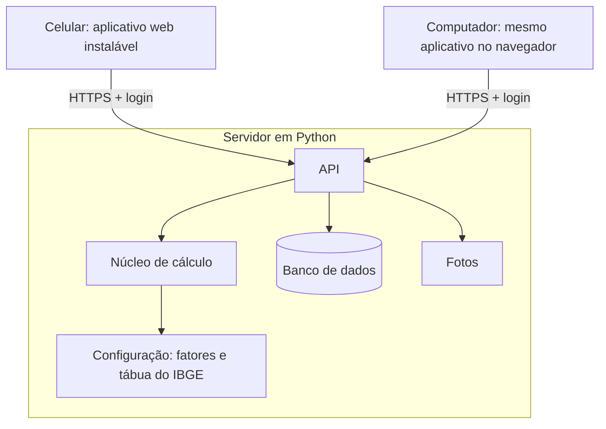

# 6. Arquitetura

## Visão geral

O sistema tem duas partes: um **servidor em Python**, que guarda os dados e faz o cálculo, e um **aplicativo web para celular**, que mostra a linha do tempo.



Todos os aparelhos falam com o mesmo servidor. É isso que mantém os dados sincronizados: o que é registrado no celular aparece no computador ao abrir a página.

## Por que duas linguagens

O núcleo de cálculo e o servidor ficam em **Python**, como preferido. A tela, porém, roda dentro do navegador do celular, e o navegador só executa JavaScript. Por isso a interface fica em **TypeScript** (JavaScript com tipos).

A divisão é clara: tudo o que é regra, número ou dado fica em Python; o TypeScript só desenha e envia o que o usuário digitou.

## Tecnologias

### Servidor

| Escolha | O que é | Por quê |
|---|---|---|
| Python 3.12 | Linguagem | Preferência do projeto; boa para cálculo e para aprender |
| FastAPI | Biblioteca para criar a API | Simples, gera documentação da API sozinha, usa os tipos do Python |
| SQLModel | Define as tabelas como classes Python | Um só lugar descreve os dados e a validação |
| SQLite | Banco de dados em um arquivo | Suficiente para um usuário; sem instalar servidor de banco. Dá para trocar por PostgreSQL depois |
| pytest | Testes | Padrão em Python |
| Senha com Argon2 e sessão por cookie | Login | A senha não fica guardada, só o código derivado; o cookie mantém o aparelho conectado |

### Aplicativo

| Escolha | O que é | Por quê |
|---|---|---|
| TypeScript | JavaScript com tipos | Os tipos pegam erros cedo |
| Vite | Roda e empacota o aplicativo | Configuração mínima; bom suporte no IntelliJ |
| Sem framework de interface, no início | HTML, CSS e TypeScript diretos | O protótipo já funciona assim; menos conceitos para aprender |
| PWA | Permite instalar o site como aplicativo | Ícone na tela inicial e tela cheia, sem loja de aplicativos |

### Hospedagem

O servidor precisa ficar acessível pela internet, com HTTPS. A escolha do serviço está em aberto (ver [Decisões](08-decisoes.md)). Durante o desenvolvimento, tudo roda no próprio computador.

## Sincronização

Na v1 a sincronização é direta: o aplicativo lê e grava no servidor a cada ação.

- Com internet, todos os aparelhos veem sempre os mesmos dados.
- Sem internet, o aplicativo mostra o que já tinha carregado, mas não aceita registros novos.

Registrar sem conexão e enviar depois exige resolver conflitos entre aparelhos. Fica para depois da v1.

## Responsabilidades

| Parte | Faz | Não faz |
|---|---|---|
| Núcleo de cálculo (Python) | Curva de sobrevivência, percentis, "e se?" | Não conhece banco, login nem tela |
| API (Python) | Login, leitura e gravação das entidades, fotos, backup, chamada do cálculo | Não contém fórmulas |
| Aplicativo (TypeScript) | Linha do tempo, granularidade, agrupamento de períodos vazios, minimapa, formulários | Não calcula estimativa nem guarda dados como fonte principal |

O núcleo de cálculo é feito de funções puras: mesma entrada, mesma saída. Isso o torna fácil de testar e de entender.

O agrupamento dos períodos por ano, mês e semana fica no aplicativo, porque precisa responder na hora quando o usuário troca a granularidade.

## Pastas

```
LifeJourney/
├── docs/                    documentação
├── prototipo/               protótipo navegável (referência visual)
├── servidor/
│   ├── app/
│   │   ├── nucleo/          cálculo: tábua, risco combinado, sobrevivência, "e se?"
│   │   ├── modelos.py       Usuário, Memória, Capítulo, Intenção...
│   │   ├── api/             login, memórias, capítulos, intenções, questionário, backup
│   │   └── config.py        lê o .env
│   ├── dados/
│   │   ├── tabua-ibge-2024.csv
│   │   └── fatores.json     HRs, prevalências e parâmetros, com fontes
│   ├── testes/
│   └── pyproject.toml
├── aplicativo/
│   └── src/
│       ├── linha-do-tempo/
│       ├── minimapa/
│       ├── telas/           entrar, memória, capítulo, intenção, questionário, backup
│       ├── estilo/          cores, tipografia
│       └── api.ts           conversa com o servidor
├── .env.exemplo             modelo do arquivo de segredos (o .env real fica fora do git)
└── dados-pessoais/          fora do git
```

## Segurança e privacidade

O sistema guarda memórias pessoais e respostas de saúde em um servidor, e o repositório é público. Regras:

- **Nada sensível no git.** Senhas, chaves e endereços ficam no `.env`. Dados reais e o caso de teste pessoal ficam em `dados-pessoais/`. Ambos estão no `.gitignore`.
- **HTTPS sempre** fora do computador de desenvolvimento.
- **Senha nunca guardada**, só o código derivado (Argon2).
- **Cada consulta filtra pelo usuário logado.** Nenhuma rota devolve dados sem login.
- **Sem cadastro aberto.** A conta é criada por um comando no servidor.
- **Fotos só para quem está logado.** Não há endereço público para as imagens.
- **Exportação sempre disponível**, para o usuário nunca depender do servidor.

## Testes

Desde o início, com pytest:

| Teste | O que garante |
|---|---|
| Importação da tábua | Expectativas batem com 76,6 / 73,3 / 79,9 / 20,8 / 24,2 |
| Perfil médio | Respostas iguais à média brasileira dão `HR_total` 1,0 |
| Limites | `q'_x` nunca passa de 1; `HR_total` respeita teto e piso |
| Calibração | Diferença entre perfis extremos perto de Li et al. (2018) |
| Login | Sem login, toda rota de dados recusa; um usuário não vê dados de outro |
| Backup | Exportar e importar devolve os mesmos dados, sem duplicar |

## Desempenho

A rolagem só cria os elementos dos períodos com conteúdo; os vazios viram uma faixa. No protótipo, a vida inteira em nível Semana gera cerca de 135 linhas. O minimapa é desenhado em `<canvas>`, porque são cerca de 5.000 semanas.

O aplicativo carrega todas as memórias de uma vez (são textos curtos) e as fotos sob demanda, conforme entram na tela.
