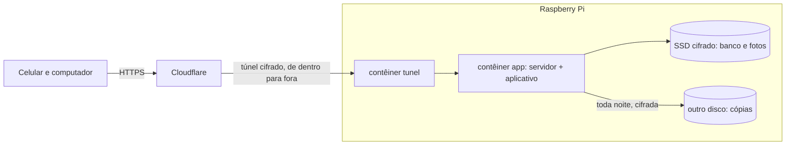

# 9. Publicação no Raspberry Pi

Passo a passo para colocar o Vida em Semanas no ar, num Raspberry Pi 4 ligado o tempo todo, junto com outros projetos.

Os comandos `bash` rodam no Pi (por SSH). Os que dizem "no seu computador" rodam no Windows.

## Como fica



- O Pi **não abre nenhuma porta** no roteador. O túnel da Cloudflare sai de dentro do Pi, e é por ele que os pedidos chegam.
- Por isso, este projeto **não conflita com os outros** do Pi, rodem eles em Docker ou direto no sistema.
- A Cloudflare cuida do HTTPS.

## O que você precisa

| Item | Para quê |
|---|---|
| Raspberry Pi 4 com Raspberry Pi OS **64 bits** | A imagem é para ARM 64 bits |
| SSD externo pela USB | Banco e fotos. Cartão SD estraga com gravação constante |
| Um segundo lugar para as cópias | Outro disco, um pendrive grande ou armazenamento em nuvem |
| Um domínio na Cloudflare | Endereço público com HTTPS (ex.: `semanas.seudominio.com.br`). Sem domínio, veja [a alternativa](#sem-dominio-tailscale) |
| O programa `age` também no seu computador | Para guardar a chave que abre as cópias |

## 1. Disco cifrado para os dados

Cifrar o SSD protege as memórias e as respostas de saúde se o Pi ou o disco for furtado. A cifra usa LUKS, o padrão do Linux.

> **Atenção:** formatar apaga tudo o que houver no disco. Confira o nome do disco com `lsblk` antes; errar o nome apaga o disco errado.

```bash
lsblk
```

Supondo que o SSD seja `/dev/sda` e esteja vazio:

```bash
sudo apt install -y cryptsetup
```

```bash
sudo cryptsetup luksFormat /dev/sda
```

```bash
sudo cryptsetup open /dev/sda dados
```

```bash
sudo mkfs.ext4 /dev/mapper/dados
```

```bash
sudo mkdir -p /mnt/dados && sudo mount /dev/mapper/dados /mnt/dados
```

```bash
sudo mkdir -p /mnt/dados/vida-em-semanas && sudo chown 1000:1000 /mnt/dados/vida-em-semanas
```

A senha do LUKS é pedida a cada vez que o Pi liga (veja [Depois de um reinício](#depois-de-um-reinicio)). Quem quiser que o Pi ligue sozinho pode guardar a chave num arquivo, mas aí ela fica no próprio Pi e protege menos. Para decidir, veja o [guia do cryptsetup](https://gitlab.com/cryptsetup/cryptsetup/-/wikis/FrequentlyAskedQuestions).

O número `1000` é o usuário que roda o servidor dentro do contêiner; ele precisa ser o dono da pasta.

## 2. Docker e o projeto

Se o Docker ainda não estiver no Pi:

```bash
curl -fsSL https://get.docker.com | sh
```

```bash
sudo usermod -aG docker $USER
```

Saia e entre de novo no SSH. Depois, baixe o projeto:

```bash
git clone https://github.com/allandpn/lifejourney.git ~/vida-em-semanas
```

```bash
cd ~/vida-em-semanas && cp .env.exemplo .env
```

O `.env` fica só no Pi: ele está no `.gitignore` e nunca vai para o GitHub.

## 3. Chave das cópias de segurança

A chave tem duas partes. A **pública** fica no Pi e serve só para criar cópias. A **privada** abre as cópias e **não pode ficar no Pi**: se ficasse, quem levasse o Pi levaria também o que abre as cópias.

No seu computador, com o [age](https://github.com/FiloSottile/age/releases) instalado:

```powershell
age-keygen -o chave-vida-em-semanas.txt
```

O comando mostra a chave pública (`age1...`). Guarde o arquivo `chave-vida-em-semanas.txt` num lugar seguro e fora do Pi: num gerenciador de senhas ou num pendrive guardado. **Sem ele, as cópias não abrem.**

## 4. Túnel da Cloudflare

1. No painel da Cloudflare, abra **Zero Trust → Networks → Tunnels → Create a tunnel**, tipo **Cloudflared**.
2. Dê um nome (ex.: `vida-em-semanas`) e copie o **token** que aparece no comando de instalação (o texto longo depois de `--token`). Não precisa rodar o comando que a Cloudflare sugere: o `docker-compose.yml` já tem o contêiner do túnel.
3. Em **Public Hostname**, adicione o endereço (ex.: `semanas.seudominio.com.br`) apontando para o serviço `http://app:8000`.

## 5. Preencher o `.env` no Pi

```bash
nano ~/vida-em-semanas/.env
```

Tire o `#` e preencha estas linhas da parte "no Raspberry Pi":

```
CLOUDFLARE_TUNNEL_TOKEN=o-token-copiado
LJ_COPIA_CHAVE_PUBLICA=age1...
LJ_PASTA_DADOS=/mnt/dados/vida-em-semanas
LJ_PASTA_COPIAS=/mnt/copias/vida-em-semanas
```

A linha `LJ_MODO=desenvolvimento` pode ficar como está: o `docker-compose.yml` força o modo produção no Pi.

Crie a pasta das cópias no outro disco (ajuste o caminho ao seu):

```bash
sudo mkdir -p /mnt/copias/vida-em-semanas && sudo chown 1000:1000 /mnt/copias/vida-em-semanas
```

## 6. Ligar

```bash
cd ~/vida-em-semanas && docker compose up -d --build
```

A primeira compilação no Pi leva alguns minutos. Depois:

```bash
docker compose ps
```

Os dois serviços devem aparecer como `running`, e o `app` como `healthy` depois de um minuto. Se algo falhar:

```bash
docker compose logs app
```

Crie a sua conta de administrador (a senha é pedida no terminal e não aparece):

```bash
docker compose exec app python -m app.contas criar-admin voce@exemplo.com
```

Abra o endereço público no celular e entre. Para convidar outras pessoas, use a tela **Conta → Gerar link de convite**.

## 7. Instalar no celular

- **Android (Chrome):** menu ⋮ → **Instalar app** ou **Adicionar à tela inicial**.
- **iPhone (Safari):** botão compartilhar → **Adicionar à Tela de Início**.

O aplicativo abre em tela cheia, com o ícone do Vida em Semanas. Ele precisa de internet para funcionar (na v1 não há modo sem conexão).

## 8. Cópia de segurança toda noite

Teste uma vez à mão:

```bash
cd ~/vida-em-semanas && docker compose exec -T app python -m app.copia fazer
```

Depois agende no `cron` do Pi, todo dia às 3h:

```bash
crontab -e
```

E acrescente esta linha (ajuste o caminho se o projeto estiver em outro lugar):

```
0 3 * * * cd $HOME/vida-em-semanas && docker compose exec -T app python -m app.copia fazer >> $HOME/copia-vida-em-semanas.log 2>&1
```

Ficam as 30 cópias mais recentes (mude com `LJ_COPIA_MANTER`). As cópias saem cifradas, então podem ir também para a nuvem, por exemplo com o [rclone](https://rclone.org/) copiando a pasta de cópias.

### Testar a restauração

Uma cópia só vale se abrir. Faça este teste uma vez, e depois de vez em quando.

1. Copie um arquivo `.age` da pasta de cópias para o seu computador.
2. Num computador com o projeto e o `age`, dentro da pasta `servidor`:

```powershell
.venv\Scripts\python -m app.copia restaurar vida-em-semanas-AAAAMMDD-HHMMSS.tar.gz.age --identidade chave-vida-em-semanas.txt --para restaurada
```

A pasta `restaurada` recebe o `lifejourney.db` e a pasta `fotos`. O comando nunca sobrescreve uma pasta com conteúdo.

### Restaurar de verdade no Pi

Se precisar voltar uma cópia no Pi:

1. Decifre a cópia no seu computador, como acima.
2. Leve as pastas para o Pi.
3. Desligue o serviço:
   ```bash
   docker compose stop app
   ```
4. Renomeie a pasta de dados atual, em vez de apagar, e ponha no lugar o `lifejourney.db` e a pasta `fotos` restaurados.
5. Garanta que o usuário `1000` é o dono:
   ```bash
   sudo chown -R 1000:1000 /mnt/dados/vida-em-semanas
   ```
6. Ligue de novo:
   ```bash
   docker compose start app
   ```

## Depois de um reinício

Quando o Pi reinicia, o SSD fica trancado até alguém digitar a senha. Enquanto isso, o serviço `app` não liga: o `docker-compose.yml` impede que ele crie um banco vazio no cartão SD. Para destrancar e ligar:

```bash
sudo cryptsetup open /dev/sda dados && sudo mount /dev/mapper/dados /mnt/dados
```

```bash
cd ~/vida-em-semanas && docker compose up -d
```

## 9. Atualizar

Faça uma cópia antes e depois atualize:

```bash
cd ~/vida-em-semanas && docker compose exec -T app python -m app.copia fazer
```

```bash
git pull && docker compose up -d --build
```

As mudanças no banco (migrações) são aplicadas sozinhas quando o servidor liga.

## Sem domínio: Tailscale

Sem domínio próprio, dá para usar o [Tailscale](https://tailscale.com/): só os aparelhos da sua conta Tailscale (e de quem você compartilhar) acessam o Pi. **Este caminho não foi testado**; o do túnel da Cloudflare foi.

1. Tire o serviço `tunel` do `docker-compose.yml`.
2. Tire o `#` da linha `ports: ["127.0.0.1:8080:8000"]`.
3. Ligue o HTTPS do Tailscale, que o login exige:
   ```bash
   tailscale serve --bg 8080
   ```
4. Apague a linha `LJ_CABECALHO_DO_IP` do `docker-compose.yml`: o Tailscale não envia esse cabeçalho, e mantê-la deixaria qualquer pessoa da rede escolher o endereço que o limite de tentativas enxerga.
5. Se o login for recusado como "pedido de outro site", o Tailscale está mudando o cabeçalho `Host` no caminho; nesse caso, me avise para ajustarmos.

## O que fica de fora nesta versão

- **Modo sem conexão:** o aplicativo não guarda dados no celular. Isso evita deixar memórias e respostas de saúde num aparelho que pode ser perdido, mas exige internet.
- **Limpeza automática dos registros (logs):** o Docker guarda os registros do servidor, que não contêm memórias nem respostas de saúde.
